<div align="center">



<p align="center">
  <a href="https://github.com/viper132"></a>
  <a href="https://github.com/viper132"></a>
  <a href="https://github.com/viper132"></a>
  
</p>

</div>

---

### `$ sysinfo --operator --verbose`

```yaml
operator: Hugo Mulana Christon [viper132]
role: Senior Geospatial Frontend & Systems Engineer
location: Indonesia (WIB / UTC+7)

workstation:
  os: Windows 11 Enterprise (Custom Riced & De-bloated)
  wm: GlazeWM (Tiling Layout) + Zebar Status Bar
  shell: Departure Mono • Oh My Posh • Git Bash (MSYS)
  telemetry: APC Back-UPS Pro Gaming (BGM2200B-MSX)

homelab_node:
  os: ZimaOS + Debian VM
  services: Docker Containers • Sonarr • NZBGet • Cloudflare Zero Trust
  automation: Hermes Agent Multi-Agent Orchestration • Telegram Bot Alerter

engineering_doctrine:
  - "Hardware-backed reality over generic mock simulations"
  - "Sub-1% idle overhead: low-latency, battery-friendly, zero AI slop"
  - "Deterministic builds & pristine commit discipline"
```

---

## ⚡ Featured Engineering & Flagship Systems

<table>
  <tr>
    <td width="50%" valign="top">
      <h3 align="left">🔌 <a href="https://github.com/viper132/apc-power-console">APC Power Console</a></h3>
      <p><b>Hardware Telemetry Console & Native Shutdown Daemon</b></p>
      <p>Real-time USB HID telemetry monitor for the <i>APC Back-UPS Pro Gaming (BGM2200B-MSX)</i>. Features a dual-interface architecture: high-refresh Kinetic Reactor Ring HUD and Enterprise IT Admin grid, paired with a resilient native Windows background daemon for automated graceful shutdown on grid failure.</p>
      <p>
        
        
        
        
      </p>
    </td>
    <td width="50%" valign="top">
      <h3 align="left">❄️ <a href="https://github.com/viper132/ha-polytron-ac">ha-polytron-ac</a></h3>
      <p><b>Home Assistant Custom Component (HACS)</b></p>
      <p>Reverse-engineered IoT integration bridging Polytron Smart Air Conditioners (Neuva Pro IoT23) into Home Assistant. Provides native climate entity controls, state synchronization, energy monitoring, and local/cloud telemetry automation without vendor app bloat.</p>
      <p>
        
        
        
        
      </p>
    </td>
  </tr>
  <tr>
    <td width="50%" valign="top">
      <h3 align="left">🛡️ <a href="https://github.com/viper132">Aegis</a></h3>
      <p><b>Unified Tunnel & VPN Desktop Orchestrator</b></p>
      <p>A native desktop management console built with Tauri v2 (Rust) and React for centralized VPN and secure tunnel configurations (OpenVPN, Cloudflare Tunnel, AWS SSM). Designed for zero-overhead, instant connection switching, and secure key hygiene.</p>
      <p>
        
        
        
        
      </p>
    </td>
    <td width="50%" valign="top">
      <h3 align="left">🛰️ <a href="https://github.com/viper132">Mission-Critical Geospatial Core</a></h3>
      <p><b>Defense GIS & High-Density Tactical Spatial Views</b></p>
      <p>Specialized geospatial engineering delivering defense-grade situational awareness displays. Real-time rendering of large-scale GIS coordinate feeds, radar tracks, and tactical telemetry using LuciadRIA 2D/3D WebGL pipeline integrated into modern React architectures.</p>
      <p>
        
        
        
        
      </p>
    </td>
  </tr>
</table>

---

## 🏗️ Hardware Topology & Homelab Architecture

```text
                      ┌─────────────────────────────────────────┐
                      │   APC Back-UPS Pro Gaming (BGM2200B)    │
                      │  [ 230V Pure Sine • USB HID Telemetry ] │
                      └────────────────────┬────────────────────┘
                                           │ USB Data
                                           ▼
┌──────────────────────────────────────────────────┐        Local LAN        ┌──────────────────────────────────────────────────┐
│  PRIMARY WORKSTATION (Win11 + GlazeWM)           ├────────────────────────►│  HOMELAB NODE (ZimaOS + Debian VM)               │
├──────────────────────────────────────────────────┤                         ├──────────────────────────────────────────────────┤
│ • APC Power Console (Tauri v2 + Rust Daemon)     │                         │ • Home Assistant (HA Polytron AC Custom Comp)    │
│ • Aegis (Unified Tunnel & Network Orchestrator)  │                         │ • Sonarr • NZBGet • Automated Data Backups       │
│ • LuciadRIA Tactical GIS & Geospatial Frontend   │                         │ • Hermes Multi-Agent Orchestration & Telegram Bot│
│ • Departure Mono • Low-Latency Terminal Workflow │                         │ • Cloudflare Zero Trust Tunnels & WireGuard Mesh │
└──────────────────────────────────────────────────┘                         └──────────────────────────────────────────────────┘
```

---

## 🛠️ Technical Matrix

<div align="left">

| Domain | Stack & Technologies |
|:---|:---|
| **Systems & Native Desktop** | `Rust` `Tauri v2` `TypeScript` `C / C++` `Bun` `Node.js` |
| **Geospatial & Spatial GIS** | `LuciadRIA (2D/3D)` `WebGL` `Mapbox / Leaflet` `GeoJSON` `Spatial Telemetry` |
| **Frontend Architecture** | `React` `Vite` `Tailwind CSS` `State Management` `High-FPS Canvas/SVG` |
| **Hardware & IoT Protocols** | `USB HID` `Home Assistant (HACS)` `MQTT` `Python` `IoT Reverse-Engineering` |
| **Infrastructure & Homelab** | `Docker` `Linux (Debian)` `ZimaOS` `Cloudflare Tunnels` `WireGuard` `Nginx` |
| **Environment & Workflow** | `GlazeWM (Tiling)` `Departure Mono` `Oh My Posh` `Git Bash` `Zero-Bloat Tooling` |

</div>

---

<details>
<summary><b>⚡ [SYS_DIAGNOSTICS] Click to inspect live telemetry & performance benchmarks</b></summary>
<br />

```bash
$ sysctl -a | grep telemetry
> power.ups.status          : ONLINE (Utility Power Normal)
> power.ups.load_pct        : 18% nominal
> power.ups.battery_runtime : 48 min remaining
> desktop.wm.engine         : GlazeWM (Tiling layout, <15MB RAM)
> desktop.font.rendering    : Departure Mono (Crisp pixel geometry)
> code.quality.discipline   : 100% Deterministic • Atomic Commits • No AI Slop
```

</details>

---

<div align="center">

### 📡 Uplink & Signal Channels

<p align="center">
  <a href="mailto:hugo.mulana@gmail.com"></a>
  <a href="https://linkedin.com/in/hugo-mulana" target="_blank"></a>
  <a href="https://matching.turing.com/developer-resume-preview/0318096db32740c45139908eba9da256605b314ee431b0" target="_blank"></a>
  <a href="https://github.com/viper132"></a>
</p>

<sub><i>"Engineered for sub-millisecond precision, zero idle bloat, and hardware-level stability."</i></sub>

</div>
